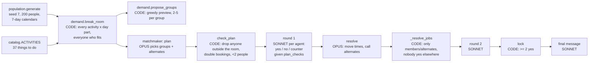

# Matching architecture: what the code actually does

Written 2026-10-27 from the code at `340da1a` (plus this session's changes), not from the
older docs. Where a doc disagrees with the code, the code wins and the mismatch is listed at
the end.

Clawnly has **two matchers** that share storage, logging and the Claude client but no
matching logic:

| | Friendship pilot (pairs) | Run Clawnly (activity groups) |
|---|---|---|
| Who | Real residents who joined through an invite link | 200 emulated neighbors (`population.py`) |
| Unit of a match | Two people invited to meet | 2+ people doing one activity, one day part |
| Agents | Two Claws talk to each other (6 messages) | Hub talks to each agent one to one; agents never talk |
| Code core | `orchestrator.py` -> `batch.py` -> `my_match.py` | `demand.py` -> `matchmaker.py` -> `run_clawnly.py` |
| Needs paid API | Every step after signup | Plan, agent replies, resolve, final message |
| Offline part | Rule checks only (`clean_pairs`, `verify_evidence`, `gate`) | The break rooms and a code-only group proposer |

---

## 1. Run Clawnly (activity groups)

### Stage by stage

**Profile input**: `population.generate(count, seed, start, days)` ([population.py:204](../src/population.py)).
A person is `{id "e001".., name, age, area, archetype, kids_at_home, likes [{tag, weight 1-3}],
dislikes [tag], avoid [trait], budget free|low|any, calendar {iso date: [day parts free]}, brief}`.
Seeded `random.Random`, so the same seed and start give the same town. Calendars follow the
archetype's weekly pattern with 35% of free parts taken (50% with kids).

**Compatibility (person x activity)**: `demand.fit(person, activity, day, part)`
([demand.py](../src/demand.py)). Returns `(score, None)` or `(0, reason)`. Exclusions, in
order: out of season, not running that weekday/part, person busy, over budget, any activity
tag the person dislikes, any activity trait the person avoids (an outdoor morning also counts
as `early_mornings`). Score = sum of the person's like weights over the activity's tags; 0
means "not interested". **There is no person-to-person compatibility in code**: two people are
"compatible" only by both fitting the same slot.

**Break rooms**: `demand.break_room(people, activities, day)` -- one slot per activity x day
part with at least `GROUP_MIN` (2) people who fit, candidates sorted keenest first. Ties in
score are ordered by `demand.tie_order(day, id)` (a per-day FNV-1a draw; before 2026-10-27
they were ordered by id, see the quality report). The JS page (`src/web/run-clawnly.js`
`fit`/`breakRoom`) is a line-for-line copy and must be kept in step.

**Code-only groups (the preview)**: `demand.propose_groups` -- sort slots by strength (sum of
the 5 keenest scores), then greedily take the 5 keenest not-yet-placed people of each slot;
keep the group if at least 2. One group per slot, one group per person per day. Used by the
`demand.py` CLI and by `match_eval.py`; **not** used by the live matchmaker.

**Live group formation**: `matchmaker.run_day` ([matchmaker.py:570](../src/matchmaker.py)).
Opus reads the rooms (keenest 8 per room with a one-line profile, the rest by id) and returns
groups, alternates and a proposal per member. `check_plan` keeps only members inside that
room, never books anyone twice, needs at least 2, caps alternates at 2 and snaps a fixed
event to its real time. The prompt *asks* for shared interests and similar stage of life;
code doesn't check either.

**Negotiation**: `_ask_agent` -- one Sonnet call per member, with the full profile and
`plan_checks` (busy, early start before 9am for early-morning avoiders, ending 9pm+ for
late-night avoiders, avoided traits, dislikes, budget, mild or no interest). Answer is
normalized to yes/no/counter; a failed call counts as "no". Opus then resolves;
`_resolve_jobs` only lets it re-ask a group's own members or alternates, never someone who
already said yes elsewhere, and never one person for two groups in round 2. A fixed event
can't be moved.

**Final match**: `lock` -- a group is locked when at least 2 members said yes (code only).
Sonnet writes one message per person. The whole run is one dict saved to
`db.matchmaker_runs` after every step; every call is also in `db.ai_calls`.

**Failure points**: Opus returns unparseable JSON -> `extract_json` gives None -> zero groups
(logged). Agent call fails -> that member is "no". Any exception -> run status "failed" with
the reason in the log. App restart mid-run -> `fail_unfinished_matchmaker_runs` at startup.

---

## 2. Friendship pilot (pairs)

```mermaid
flowchart LR
  paste[pasted AI portrait] --> card[dossier.build_card<br/>SONNET -> clean_card]
  card --> pair[choose_pairs<br/>SONNET picks pairs]
  pair --> cpairs[clean_pairs<br/>CODE: known ids, no self/repeat,<br/>&lt;=2 per person, &lt;=6 per round]
  cpairs --> talk[agent_talk.converse<br/>SONNET x 6 turns]
  talk --> judge[judge<br/>OPUS: depth, quotes, invite]
  judge --> gate[verify_evidence + gate<br/>CODE: recommend, depth>=8,<br/>>=2 verbatim quotes from BOTH agents]
  gate --> pick[batch.pick_invitations<br/>CODE: one per person, strongest first]
  pick --> blind[_blind + create_invitation]
  blind --> yesno[my_match: pending -> waiting -> sealed / dissolved]
```

Profile = the pasted text (`dossier_text`, 400-8000 chars) plus a structured card. Pair
compatibility is entirely the hub's judgment; code enforces limits and the evidence rule.
Triggers: first round when eligible joins reach the neighborhood threshold
(`batch.check_and_trigger_batch`, compare-and-swap), then nightly (`nightly.py`), or an admin
button (`force_trigger_batch`). Every step is a `db.events` row. Nothing here can run without
a paid key; its tests use `tests/conftest.py`'s `FakeClient`.

---

## 3. Shared plumbing

- `config.py`: `MODEL_REASONING = claude-sonnet-5`, `MODEL_PREMIUM = claude-opus-5-5`, effort
  "medium" for both. `get_client()` raises without `ANTHROPIC_API_KEY`.
- `ai_log.LoggedClient`: wraps the client, writes every call verbatim to `db.ai_calls`,
  classifies its purpose by a marker phrase in the system prompt.
- `llm_io.extract_json`: first `{` to last `}`; None on failure (callers treat None as "nothing").
- `db.py`: one SQLite file, one shared connection, plain SQL; one-shot state changes use
  `UPDATE ... WHERE <old state>` and check `rowcount`.

## 4. Where the docs and the code disagree

- README says agent turns run on "Claude Sonnet 4.6"; `config.py` uses `claude-sonnet-5`.
- `config.py` says aliases are "one of the three tiers above"; there are two.
- `docs/ACTIVITY_PLAN.md` draws "2. PROPOSE (code)" between the break room and negotiation.
  In the live matchmaker Opus proposes; the code proposer is only the CLI preview.
- `docs/ACTIVITY_PLAN.md` lists "travel" among what the hub reads; there is no travel field.
  `area` is stored but used nowhere in matching (only shown to Opus).
- `catalog._a` writes the `traits/days/parts/months/cost/outdoor` keys twice in one dict
  literal (harmless, the second wins with the same values).

## 5. Known limitations (for the evaluation)

- Calendars repeat: two weeks that start on the same weekday get **identical** calendars for
  the same seed, because the generator draws the same numbers in the same order.
- The code proposer allows one group per slot, so a room of 30 keen people yields one group of
  5; the live matchmaker can make several groups per room.
- Nothing remembers earlier days: the same people can be grouped for the same activity on
  consecutive days.
